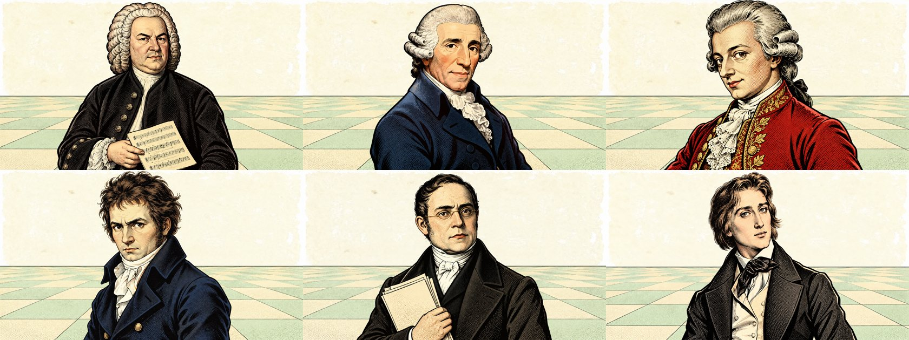
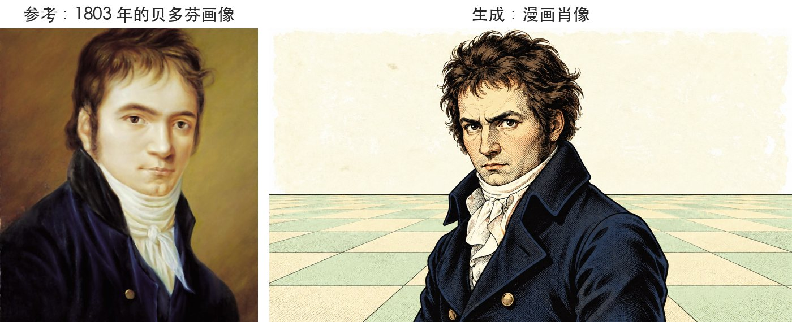
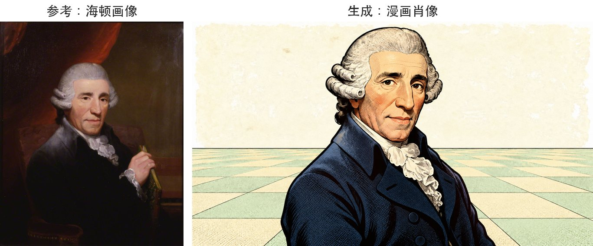
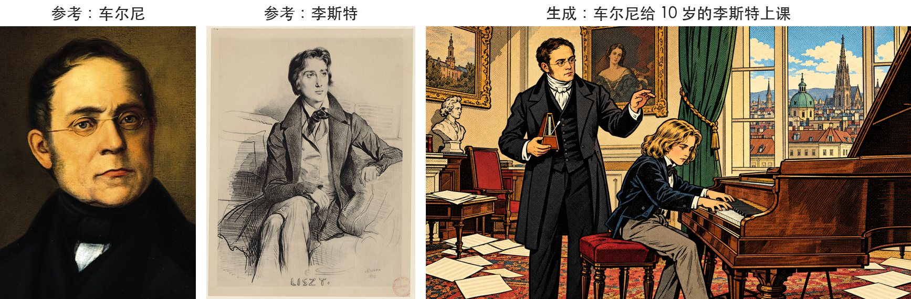
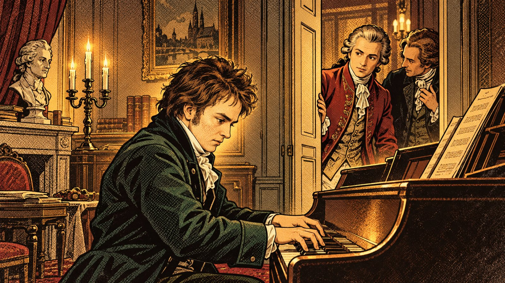
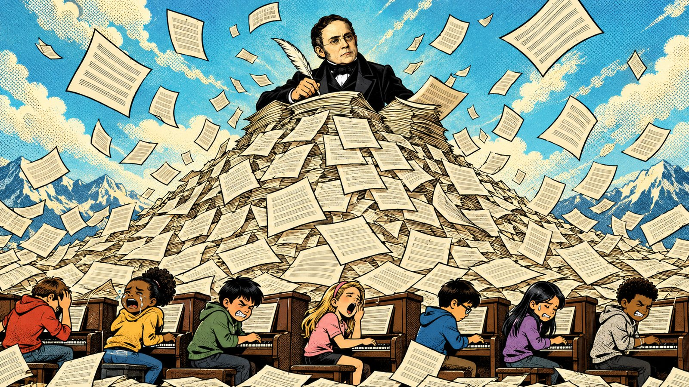
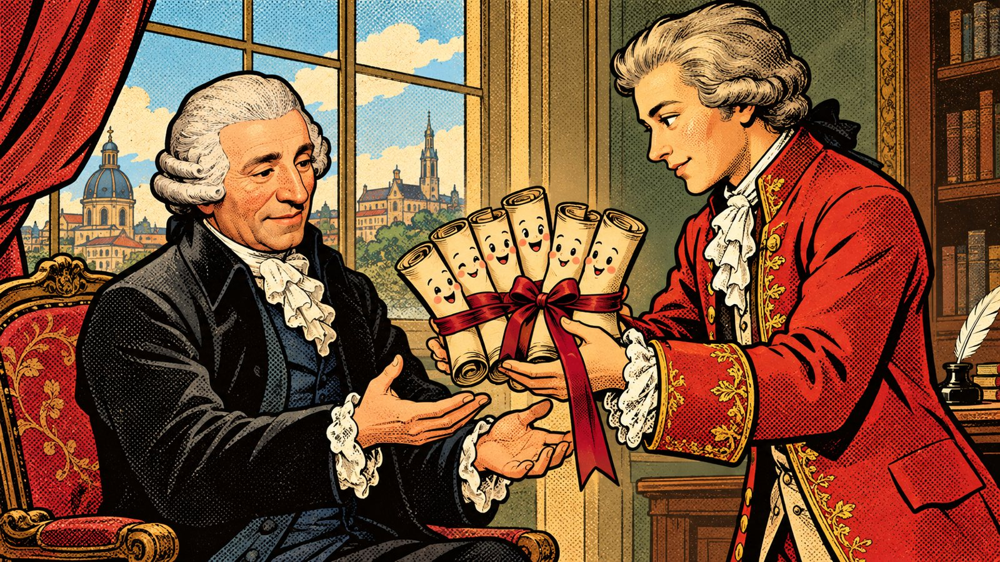
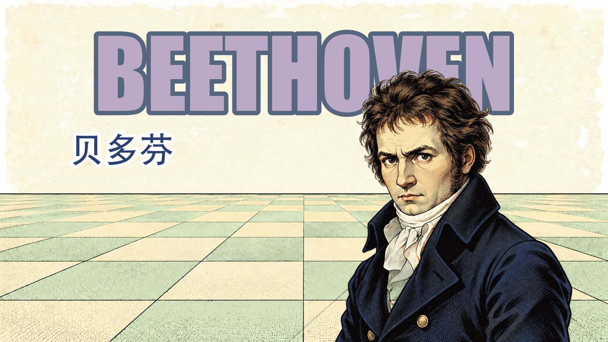
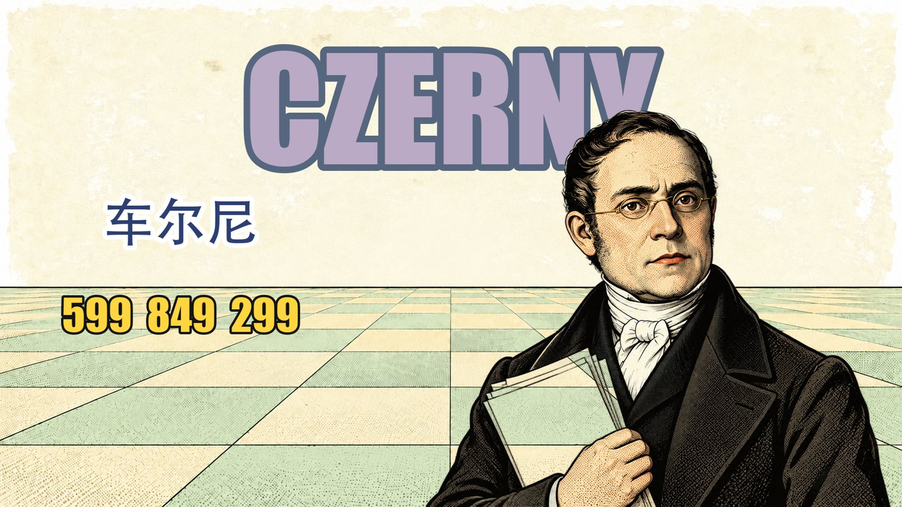

最近做了一条讲钢琴家师承的视频《钢琴家往事》，里面的巴赫、海顿、莫扎特、贝多芬、车尔尼、李斯特，以及 30 多张历史场景，全部是用 Codex 的内置生图工具画的。这篇把提示词的写法整理出来，照着改就能用。



## 一、提示词 = 单张描述 + 类型说明 + 统一风格

每张图的提示词都由三段拼起来，再附上几张参考图：

```
<单张描述：这张图画什么>
<类型说明：肖像 / 场景 / 立绘，各有固定构图要求>
<统一风格：所有图共用，保证全片画风一致>
```

后两段对所有图都一样，写一次就行。每张图只需要写第一段。我把它们放在一个 JSON 里，用脚本批量拼接、批量出图：

```json
{
  "style": "统一风格……",
  "kinds": {"portrait": "肖像的构图要求……", "scene": "场景的构图要求……"},
  "assets": [
    {"id": "pt_beethoven", "kind": "portrait", "refs": ["风格参考图", "贝多芬历史画像"], "prompt": "单张描述……"}
  ]
}
```

## 二、统一风格（每张都带）

```
风格严格参考附带的风格参考图：复古美式漫画/波普艺术风格，粗黑墨线勾边，
本戴点(Ben-Day dots)网点阴影，平涂色块，略带做旧纸张颗粒质感，色彩饱和但偏复古。
不要复制参考图里的任何文字、水印、logo。
画面中无任何文字、无水印、无乐谱上可读的字。16:9横版。
```

风格参考图我用的是参考视频的几张截图。只靠文字描述，画风很难稳定；附上同一组截图，30 多张图的画风才能统一。

## 三、类型说明

**肖像**：用于人物第一次出场的大标题镜头。

```
半身肖像构图严格参考 portrait.png（人物半身居中，略侧身看向观众，占画面高度约90%）；
背景是米白天空与浅薄荷绿地砖，人物身后不要有其他东西。
人物五官、发型、服装严格参考附带的历史肖像，但完全用漫画画法重绘。
```

背景刻意画得很干净，后面方便抠图、加大字标题。

**场景**：

```
完整场景插画，16:9构图，人物五官参考附带的历史肖像，但完全用漫画画法重绘。
```

## 四、样例

### 1. 贝多芬肖像

参考图：风格截图 + 两幅贝多芬历史画像（Wikimedia Commons，公有领域）

```
1801年、30岁的贝多芬：浓密蓬乱的深棕色头发，浓眉，坚毅略带烦躁的眼神，
深蓝色高领外套、白色领巾随意系着。神情倔强。
```



### 2. 海顿肖像

```
60岁的海顿：五官参考 haydn.jpg（长脸、鹰钩鼻、白色扑粉假发两侧卷起），
深蓝色礼服、白色领巾，慈祥但有点精明的表情。
```



### 3. 多人场景：车尔尼给 10 岁的李斯特上课

参考图：风格截图 + 车尔尼画像 + 李斯特画像

```
1822年维也纳，一间温暖的十九世纪初琴房：31岁的车尔尼（参考 czerny.jpg 的五官，
但更年轻：深色短发、圆框小眼镜、深色礼服、高领白领巾）站在一架维也纳式三角钢琴旁，
一手拿着节拍器指点，神情严肃认真；钢琴前坐着一个10岁的金色及肩长发小男孩
（少年李斯特，参考 liszt.jpg 的发型与脸型但是孩子），穿深色短外套，
双手在琴键上飞快弹奏，表情专注。窗外是维也纳的屋顶，墙上挂着画框，地上散落着乐谱纸。
```



车尔尼的画像是他晚年的样子，提示词里写明"31岁……但更年轻"，画出来就是年轻版的他，五官还认得出来。

### 4. 有情绪的场景：一段传说

```
回忆色调的场景（整体偏暖褐色、略带朦胧光晕和做旧感，像一段传说）：
1787年维也纳莫扎特家的客厅，一个16岁的少年（少年贝多芬：深棕色蓬乱短发、圆脸、浓眉、
穿朴素的深绿色外套）坐在钢琴前全神贯注地即兴弹奏；31岁的莫扎特（扑粉卷发、红色礼服）
站在门边，一手扶着门框侧耳倾听，表情从漫不经心变得惊讶认真，正侧头对身旁的朋友低声说话。
```



### 5. 夸张漫画：把比喻画出来

```
夸张漫画：车尔尼（深色短发、圆框小眼镜、黑礼服）站在一座由成千上万页乐谱堆成的高山顶上，
还在奋笔疾书，乐谱像雪片一样往下飘；山脚下是一排现代的小琴童（不同肤色的孩子，
穿现代衣服）坐在立式钢琴前，有的哭、有的打哈欠、有的咬牙坚持。
```



```
温暖的比喻漫画：28岁的莫扎特（扑粉卷发、红色礼服）郑重地把六卷用缎带系好的乐谱手稿
递给52岁的海顿（白色扑粉假发）；六卷乐谱上画着可爱的小脸，像六个孩子一样；
海顿张开双手接过，感动地微笑。
```



## 五、文字后加

提示词里明确写了"画面中无任何文字"，标题、名牌、日期、引言卡片全部用 Python（PIL）后加。生图模型写中文经常出错，自己排版的字准确、可控，也方便修改。





## 六、让人物画得像的 6 条经验

1. **一定附历史肖像**：在 Wikimedia Commons 找公有领域的油画或石版画当参考图。提示词里点名"参考 xxx.jpg 的五官"，同时要求"完全用漫画画法重绘"。
2. **写清当时的年龄**：历史画像常常画的是晚年，不写年龄就会画老。
3. **同一个人用同一组外貌关键词**：贝多芬固定写"深棕色蓬乱头发、浓眉、深色外套"，在不同的图里才是同一个人。
4. **风格靠参考图锁定，文字只是补充**：每张图都附同一组风格截图。
5. **要叠字的地方提前留空**：比如"画面上方留出约四分之一的空白区域（之后会放大标题字）"。
6. **反向要求写清楚**：比如"不要复制参考图里的文字、水印、logo""人物身后不要有其他东西"。这些反向要求能省掉很多返工。

## 七、出图命令

用的是 Codex CLI 的内置生图工具，一张图一条命令：

```bash
codex exec --skip-git-repo-check -s read-only \
  -i style_ref.png -i beethoven.jpg \
  -- "调用内置图像生成工具生成一张图，不要做其他任何事情。以附带的图片作为参考图进行编辑。
画面要求：<单张描述>
<类型说明>
<统一风格>"
```

生成的图在 `~/.codex/generated_images/` 下。我用一个小脚本读取上面那个 JSON，拼好提示词，4 张图并发出图。遇到额度用完就等恢复后自动续跑，已经画好的图会跳过。整片 37 张图基本一次通过，只重画了一张背景。

---

视频：《钢琴家往事》。人物参考的历史肖像均来自 Wikimedia Commons（公有领域）。
