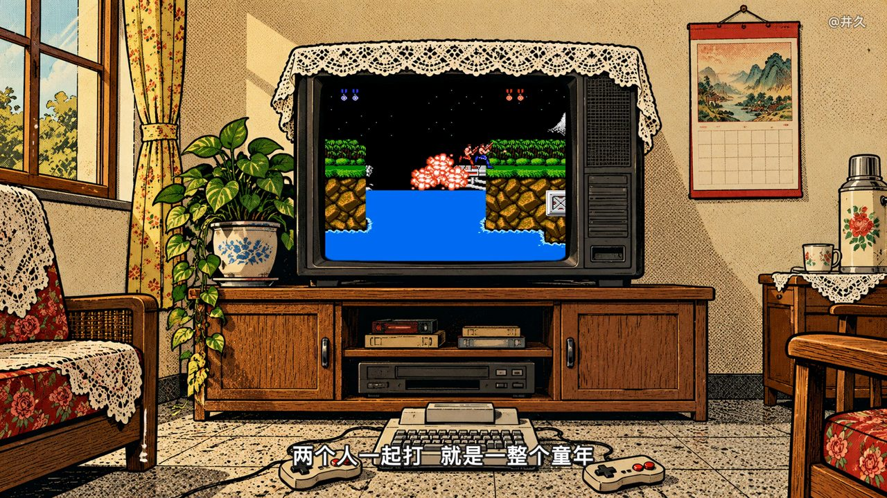
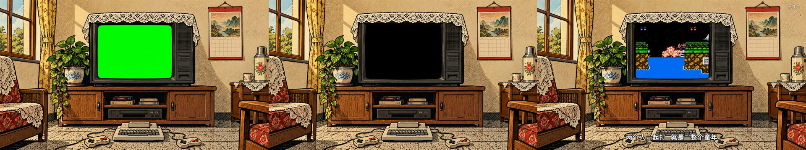
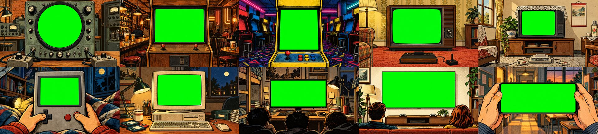
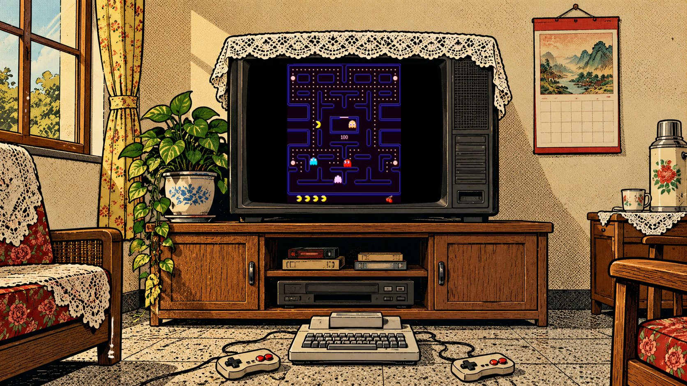
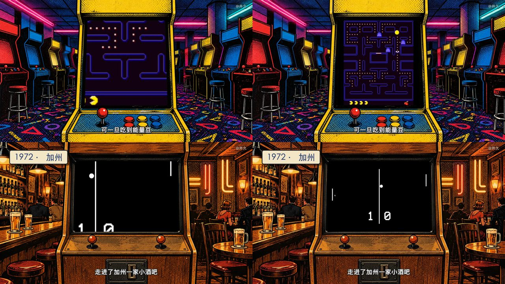
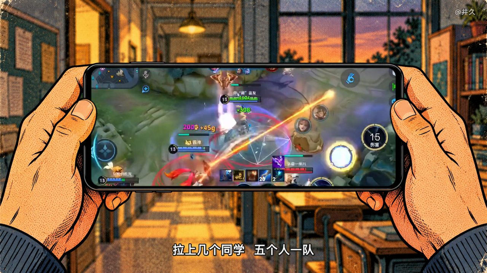

新视频《游戏往事》讲游戏六十多年的故事，用到了 20 段真实游戏画面：双人网球、Pong、吃豆人、马里奥、魂斗罗、俄罗斯方块、王者荣耀、黑神话……直接把录像剪进漫画视频，画风会断成两截。我的做法是给每个年代画一个漫画风格的“设备画框”，屏幕留成绿幕，再把录像塞进去。



这篇讲具体怎么做，上一篇[《用 Codex 画历史人物漫画》](/posts/comic-character-prompts/)讲的是人物和场景的画法。

## 一、工具

| 用途 | 工具 |
|---|---|
| 画画框 | Codex CLI 内置生图 |
| 找绿幕、挖空 | Python（Pillow + numpy + scipy） |
| 截片段、叠画面 | ffmpeg |
| 检查录像里有没有解说人声 | whisper.cpp |

## 二、流程

```
画画框（屏幕涂纯绿）→ 找出绿色窗口、做两层图 → 截取并裁切录像 → 三层叠加：底图 / 录像 / 挖空的画框
```



## 三、画画框

画框的提示词也是“单张描述 + 类型说明 + 统一风格”三段（详见上一篇）。关键是类型说明里把屏幕要求写死：

```
完整的16:9画面，用作视频画中画的边框。画面里有一块屏幕，
屏幕区域用纯绿色(#00FF00)平涂填满：屏幕内只有纯绿色，
没有任何纹理、网点、反光、阴影、扫描线或线条；屏幕外的一切都按漫画风格画。
```

单张描述写清楚设备、屏幕比例和周围环境。比如九十年代中国客厅：

```
九十年代中国普通家庭的客厅：一台老式显像管彩电放在木质电视柜上，
电视屏幕是纯绿色的、四角略圆的4:3长方形（宽约占画面宽度的50%，居中略偏上），
电视上盖着一块白色钩花蕾丝罩布，电视旁放着一盆绿萝；电视柜前面的地板上
是一台带键盘的游戏学习机（无品牌字样），两根手柄的线拖在地上；
墙上挂着老式挂历（挂历上不要有字），暖黄色灯光。
```

屏幕比例要按游戏来写：街机竖屏写 3:4，Game Boy 写 10:9，红白机和电脑写 4:3，手机写约 2.2:1。

这期一共画了 10 个，按年代排下来，画框本身就在讲设备的演变：



## 四、找出绿色窗口

判断“绿”的条件：绿色通道比红、蓝都高出 60 以上。

```python
import numpy as np
from PIL import Image, ImageFilter
from scipy import ndimage

a = np.asarray(Image.open("frame.png").convert("RGB")).astype(int)
green = (a[..., 1] - np.maximum(a[..., 0], a[..., 2]) > 60) & (a[..., 1] > 120)

# 画框里的绿植、霓虹灯也是绿的：只留面积最大的一块，再把里面的小洞填上
lab, n = ndimage.label(green)
sizes = ndimage.sum(green, lab, range(1, n + 1))
green = ndimage.binary_fill_holes(lab == np.argmax(sizes) + 1)

mask = Image.fromarray((green * 255).astype("uint8")).filter(ImageFilter.MaxFilter(5))  # 外扩几像素，吃掉绿边
ys, xs = np.nonzero(np.asarray(mask))
x0, y0, x1, y1 = xs.min(), ys.min(), xs.max() + 1, ys.max() + 1   # 窗口位置

frame = Image.open("frame.png").convert("RGBA")
base = frame.copy(); base.paste((0, 0, 0, 255), mask=mask); base.save("base.png")   # 底层：窗口涂黑
top = frame.copy(); top.putalpha(Image.eval(mask, lambda v: 255 - v)); top.save("top.png")  # 顶层：窗口挖空
```

“只留最大一块”是踩坑后加的：第一版没加，客厅里的绿萝、街机厅的绿色霓虹都被算进窗口，录像位置和大小全算错了。

做成上下两层，是为了让画框的装饰（屏幕边框、拇指、蕾丝罩布）能压在录像边上，看起来像录像真的在屏幕里。

## 五、截取和裁切录像

网上下载的录像几乎都要先裁一下：

- **水印**：B 站视频常有 UP 主的名字和 bilibili 标志，有的还压在分数上。
- **多余的东西**：模拟器窗口的标题栏、手机录屏下半截的虚拟手柄、左右黑边。
- **解说**：有的录像带解说字幕，只裁游戏区域。

```bash
ffmpeg -ss 16.5 -i pacman.mp4 -t 6 \
  -vf "crop=946:1150:66:116" -c:v libx264 -crf 18 clip.mp4   # crop=宽:高:x:y
```

有的录像还混着 UP 主的解说声。我用 whisper.cpp 把每段原声识别一遍，识别出成句人声的就静音。纯游戏声大多会被识别成“(音乐)”或空白。

```bash
whisper-cli -m ggml-base.bin -l zh -nt -f clip_16k.wav
```

## 六、三层叠加

```bash
# 窗口 466x339，位置 (606,155)；竖屏吃豆人完整放入：缩到高 339，宽 279，水平居中 x=606+(466-279)/2=699
ffmpeg -loop 1 -i base.png -i clip.mp4 -loop 1 -i top.png -filter_complex \
  "[1:v]scale=-2:339[g];[0:v][g]overlay=699:155:shortest=1[m];[m][2:v]overlay=0:0" \
  -t 6 -r 30 -c:v libx264 -crf 18 -pix_fmt yuv420p out.mp4
```

overlay 的坐标由窗口位置和录像缩放后的尺寸算出来，让录像在窗口里居中。



**录像怎么放进窗口，分两种情况：**

- **铺满（cover）**：录像等比放大到盖住整个窗口，多出来的部分被顶层画框盖住。适合宣传片、3D 游戏这类四边没有关键信息的画面。
- **完整放入（contain）**：录像等比缩小到完全放进窗口，空出来的地方是黑边。适合老游戏：Pong 的球拍、吃豆人的迷宫、马里奥的分数都贴着画面边缘，铺满会被切掉。



老游戏完整放进屏幕留点黑边，反而更像在老电视上玩。

## 七、旁白和游戏原声

游戏原声是记忆点，比如吃豆人的“哇卡哇卡”、马里奥的跳跃声，不能丢；但它又会和旁白打架。做法是原声单独铺一轨：

- 有旁白的时候，原声压到 **-15 dB**；
- 旁白一说完，0.4 秒内抬到 **-4 dB**，让游戏自己发声；
- 这段画面里的背景音乐再额外压低 **9 dB**，给原声让路。

所以每个录像镜头都会在旁白之后多留 1～3 秒，让原声“露个脸”。

## 八、几条经验

1. **画框跟着年代走**：示波器 → 街机 → 显像管电视 → Game Boy → 液晶电视 → 手机，换画框就是换时代，观众不用看字幕也知道到了哪一年。
2. **屏幕比例写进提示词**：比例对上了，录像放进去就不用硬拉或大面积留黑边。
3. **只认最大的一块绿**：生图模型很爱在画框里加绿植。
4. **老游戏完整放入，新游戏铺满**。
5. **录像先查水印和人声**：用眼看四个角，用 whisper 听一遍。



---

视频：《游戏往事》。游戏画面为短片段引用，版权归各游戏公司所有。
